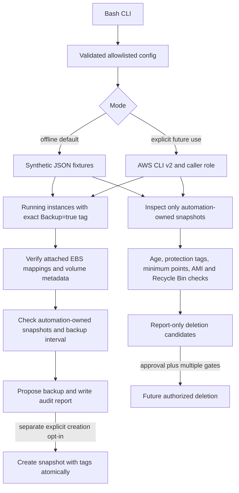

# AWS EBS Snapshot Automation and Retention

Code Clinic Lab 5 is a modular Bash + AWS CLI v2 framework for selecting running EC2 instances tagged `Backup=true`, validating attached EBS volumes, proposing tagged snapshots, and evaluating retention. It is a code-only lab: the default mode uses synthetic fixtures and does not contact AWS.

## Original assignment

> Write a Bash + AWS CLI script that snapshots all EBS volumes attached to running instances tagged `Backup=true` and applies a retention policy (delete snapshots older than 30 days).

This project extends that task with duplicate prevention, retention protection, structured reports, mock-based tests, and explicit execution gates.

## Architecture



This depicts intended future operation. No AWS credentials, API calls, snapshots, or deletions were used for this lab.

## Features

- Selects instances only when state is `running` and the configured backup tag matches exactly.
- Includes root and additional EBS mappings; ignores instance-store mappings.
- Verifies volume state, attachment, size, type, and encryption metadata before proposing backup.
- Handles multiple configured regions, duplicate volume IDs, empty results, malformed responses, and partial region failures.
- Uses a configurable 24-hour duplicate-prevention interval and deterministic `--reference-time` for offline testing.
- Tags new snapshots with ownership, policy, source volume/instance, environment, and creator metadata through `TagSpecifications`.
- Considers only completed snapshots with the automation ownership tag for retention.
- Keeps snapshots at the exact retention boundary; a snapshot expires only when its timestamp is strictly older than the cutoff.
- Blocks candidates with protection/hold tags, invalid metadata, AMI references, applicable Recycle Bin rules, or insufficient minimum recovery points.
- Writes separate backup and retention JSON reports; proposals are not reported as completed actions.

## Repository structure

- `bin/ebs-backup.sh`: CLI, mode authorization, and orchestration.
- `lib/`: config parsing, AWS/fixture adapter, discovery, snapshot creation, retention, logging, and reports.
- `config/`: base and dev/stage/prod configuration examples.
- `examples/`: synthetic EC2, EBS, snapshot, AMI, Recycle Bin, and report data.
- `tests/`: Bats tests and a mock AWS CLI command.
- `iam/`: illustrative least-privilege policy, not deployed.
- `docs/`: architecture, security, retention, recovery, and limitations.
- `.github/workflows/bash-ci.yml`: validation-only CI.

## Prerequisites and installation

Requires Bash 4.4+, AWS CLI v2 for future live modes, `jq`, and GNU `date` for UTC parsing. Tests require Bats-core, ShellCheck, and shfmt.

On Ubuntu/Debian, install local tooling with:

```sh
sudo apt-get update
sudo apt-get install -y bash jq bats shellcheck shfmt
```

No Python package, AWS credential, cloud account, or infrastructure deployment is needed.

## Offline CLI usage

Run from the repository root. All documented lab commands are offline:

```sh
# Help
bash ./bin/ebs-backup.sh --help

# Simulate snapshot selection and duplicate prevention
bash ./bin/ebs-backup.sh --mode offline --action backup --fixtures examples/ \
  --reference-time 2026-11-05T12:00:00Z

# Analyze managed snapshot retention
bash ./bin/ebs-backup.sh --mode offline --action retention --retention-days 30 \
  --fixtures examples/ --reference-time 2026-11-05T12:00:00Z

# Combined run and a combined machine-readable report
bash ./bin/ebs-backup.sh --mode offline --action all --fixtures examples/ \
  --reference-time 2026-11-05T12:00:00Z --output reports/combined-summary.json

# Load an allowlisted configuration file (the file is parsed, never sourced)
bash ./bin/ebs-backup.sh --config config/backup.example.conf --action all --fixtures examples/
```

The run writes `reports/backup-summary.json` and `reports/retention-summary.json`. `--output` additionally writes a combined report. Offline mode refuses mutation calls even if code accidentally reaches the AWS adapter.

### Configuration

Configuration supports `AWS_REGIONS`, `BACKUP_TAG_KEY`, `BACKUP_TAG_VALUE`, `RETENTION_DAYS`, `MIN_RECOVERY_POINTS`, `BACKUP_INTERVAL_HOURS`, `MANAGED_BY_TAG`, `BACKUP_POLICY_TAG`, `EXECUTION_MODE`, safety flags, `REPORT_DIRECTORY`, `LOG_LEVEL`, `ENVIRONMENT`, and `REFERENCE_TIME`. The parser accepts only known simple assignments and quoted arrays; it does not evaluate shell expressions. Still use only trusted configuration files.

Defaults: exact `Backup=true`, 30-day retention, 24-hour duplicate interval, one remaining recovery point per source volume, offline mode, dry-run, and no creation/deletion permission. Negative/invalid periods, malformed regions, unsupported modes, and contradictory mutation flags are rejected.

### Future authorized live modes

The live paths are implemented but were not executed. Discovery is read-only. Snapshot creation requires all of:

```sh
bash ./bin/ebs-backup.sh --mode live-snapshot --action backup --execute \
  --allow-snapshot-creation --config config/dev.example.conf
```

Cleanup has additional gates and an operator-controlled governance assertion:

```sh
AWS_EBS_CLEANUP_APPROVED=true bash ./bin/ebs-backup.sh --mode live-cleanup \
  --action retention --execute --allow-snapshot-deletion \
  --confirm-deletion DELETE-MANAGED-EBS-SNAPSHOTS --config config/dev.example.conf
```

These examples are not lab commands. Do not use them without explicit account authorization, change approval, reviewed IAM, restore testing, and governance checks. The cleanup variable asserts the operator has reviewed compliance/legal holds, recovery-point requirements, Recycle Bin applicability, and organizational policy. The program cannot prove every account-level constraint.

## Discovery and backup behavior

The program uses paginated `describe-instances` filters for running state and the configured tag, then locally verifies both. It collects instance name, region, AZ, environment, policy tag, and unique EBS volume IDs. `describe-volumes` metadata must confirm an in-use volume attached to that instance, positive size, volume type, and encryption state. Missing/invalid metadata produces an error and prevents that volume from becoming a snapshot proposal.

Before proposing a snapshot, managed completed snapshots are matched by `SourceVolumeId`. A recent point younger than the configured interval causes a skip with the existing snapshot ID and reason. The exact interval boundary is eligible for a new proposal. Concurrent runs can still race; production should use a distributed lock or single-writer orchestrator.

Proposed snapshot tags include `ManagedBy`, `BackupPolicy`, `SourceVolumeId`, `SourceInstanceId`, `Environment`, and `CreatedBy`. Tags are passed in the create request so ownership is attached atomically. The report distinguishes `planned` from `created` and only the live API response can count as created.

## Retention and safety behavior

Retention evaluates only current-account snapshots returned by `describe-snapshots --owner-ids self` and tagged with the configured automation owner. Unmanaged snapshots are ignored. A candidate must be completed, have valid ownership/source/time metadata, be strictly older than the cutoff, not have `BackupProtected=true`, `ComplianceHold=true`, `LegalHold=true`, or `RetentionExempt=true`, and leave the configured minimum count of completed recovery points.

The CLI also checks AMI block-device references and EBS snapshot Recycle Bin rules; inability to complete either check blocks the candidate. Matching Recycle Bin rules are conservatively surfaced for operator review. The script does not claim AMI checks alone guarantee deletion safety. Read-only AWS CLI requests use standard retries, while snapshot creation and deletion use a single attempt to avoid blind retries of non-idempotent mutations. Deletions are gated and rechecked immediately before use. A race can remain between final check and API action, which is why production needs serialization and account-level controls.

Expired snapshots may appear both in the expired list and in protected snapshots so the report shows age and the reason deletion is blocked. `deletion_candidates` are proposals; only `snapshots_deleted` means AWS accepted a delete request.

## Logging and reports

Logs are JSON lines with UTC timestamp, level, action, region, instance, volume, snapshot, result, and a safe message. No credential or secret values are logged. Reports include selection totals, proposed/created/skipped snapshots, retention decisions, protected points, candidates, completed deletes, and errors. Offline reports always say `mutations_executed: false`.

Example report shapes are in `examples/backup-report.example.json` and `examples/retention-report.example.json`.

## IAM security

The example policy separates read-only discovery from create/tag/delete actions. Several EC2 Describe APIs require `Resource: "*"`; that exception is isolated and documented. Snapshot creation/deletion uses snapshot and volume ARNs plus ownership-tag conditions where supported. Recycle Bin rule inspection needs `rbin:ListRules`. Replace the synthetic example account ID and validate exact action/resource support for the target environment. Prefer separate discovery and mutation roles, temporary credentials, narrow regions, and organizational SCPs.

## Idempotency and recovery considerations

Repeated offline runs with the same fixtures and `--reference-time` produce equivalent reports without modifying fixtures. Live duplicate checks are not a distributed lock. EBS snapshots are incremental after the initial snapshot, and deleting an older snapshot does not necessarily remove blocks used by later snapshots. Snapshot retention does not guarantee an RPO. Individual snapshots are not automatically application-consistent; databases and multi-volume applications need coordination. Test recovery and KMS access before enabling any cleanup.

AWS Backup or Amazon Data Lifecycle Manager may be preferable for managed scheduling, lifecycle, governance, and audit. EventBridge, SSM, cross-region copies, notifications, monitoring, and compliance reporting are future enhancements only and are not provisioned here.

## Testing and CI

```sh
bash -n bin/ebs-backup.sh lib/*.sh tests/helpers/mock_aws.sh
shellcheck -x bin/ebs-backup.sh lib/*.sh tests/helpers/mock_aws.sh
shfmt -d -i 2 -ci bin lib tests
bats tests
```

All AWS interactions in tests are mocked. Tests cover eligibility, EBS mapping/volume checks, multi-region fixtures, duplicate prevention, tag specifications, retention boundary, protected and AMI-referenced snapshots, offline no-AWS behavior, bad configuration, and cleanup gates. GitHub Actions installs validation tools and runs only offline tests and JSON validation; it has read-only repository permissions and no AWS credentials/OIDC, schedule, deployment, snapshot, or deletion job.

## Troubleshooting

- **No eligible instances:** verify exact tag key/value and running state in fixture or approved account.
- **Volume skipped:** inspect block-device EBS mappings, attachment state, and `describe-volumes` metadata.
- **Duplicate skipped:** inspect completed managed snapshots tagged with the same source volume and the backup interval.
- **Expired but protected:** use the report reason; check hold tags, minimum recovery-point count, AMI references, and Recycle Bin rules.
- **Live mode blocked:** satisfy every explicit mode/execute/allow/confirmation gate; do not remove safeguards to silence the error.
- **Malformed fixture:** validate JSON with `jq`; errors are included in reports and result in a nonzero exit.

## Limitations

No AWS account was accessed, no credentials were configured, and no EC2/EBS/IAM resource was created, modified, or deleted. Synthetic fixtures cannot validate actual AWS API behavior or IAM evaluation. The tool has no distributed lock, no application quiescing, and cannot discover every external compliance or recovery dependency. Snapshot consistency, Recycle Bin retention, KMS permissions, legal holds, and restore readiness still need production-specific review.
