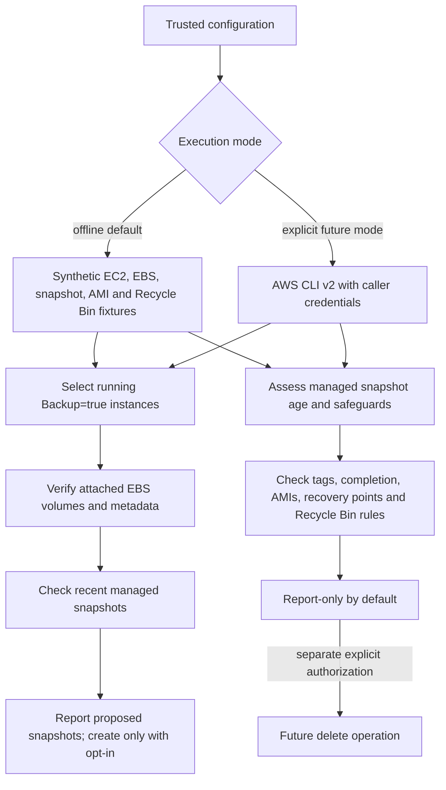

# Architecture

The default entry point is an offline fixture runner. It parses only the supplied synthetic JSON, selects running instances with an exact `Backup=true` tag, joins EBS mappings with volume metadata, checks for recent automation-owned snapshots, and produces backup and retention reports.

The live modes are code paths only; this lab does not authenticate to AWS. AWS CLI's normal pagination is retained. Reports distinguish proposed actions from operations accepted by AWS. Snapshot creation uses `TagSpecifications` so lifecycle tags are attached atomically.

## Boundaries

Snapshots are point-in-time copies of individual volumes. This program does not quiesce applications or coordinate multi-volume snapshots. AMI reference checking and tag checks are safety signals, not proof that deletion meets all legal, operational, Recycle Bin, or recovery requirements.
